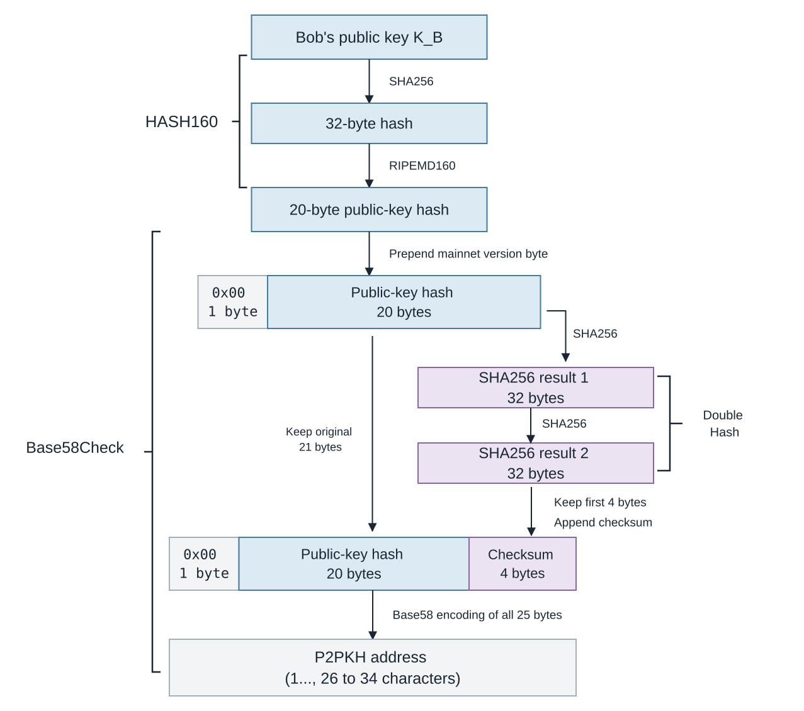
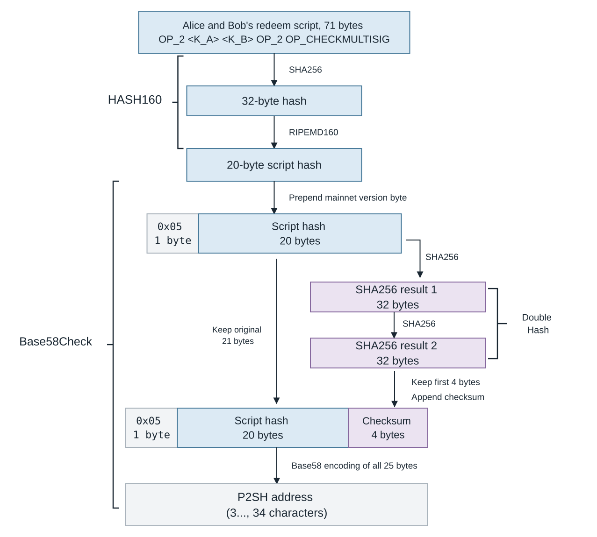
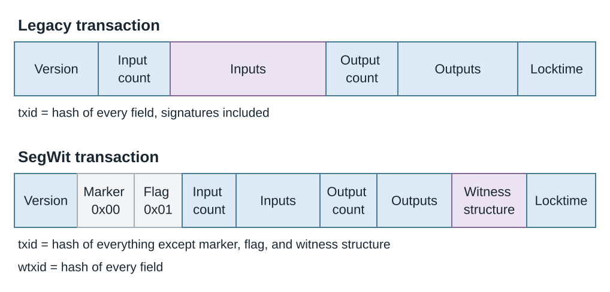
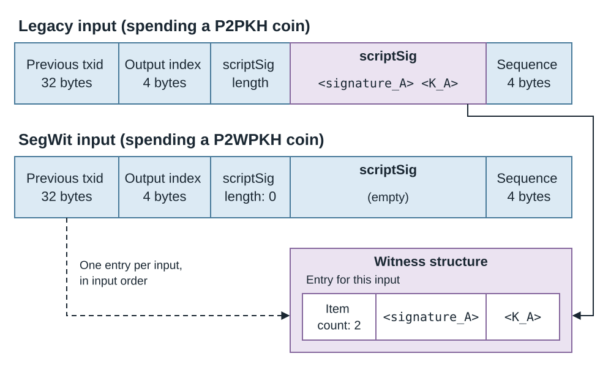
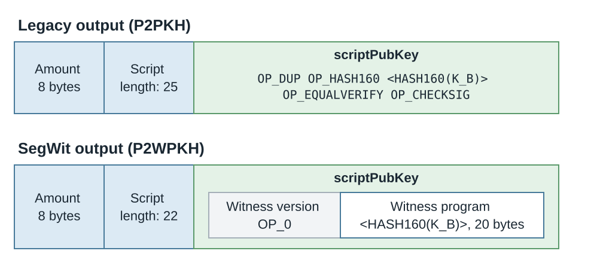
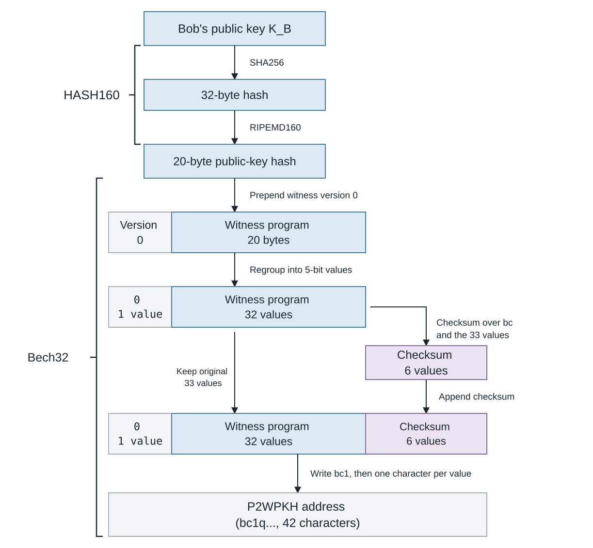
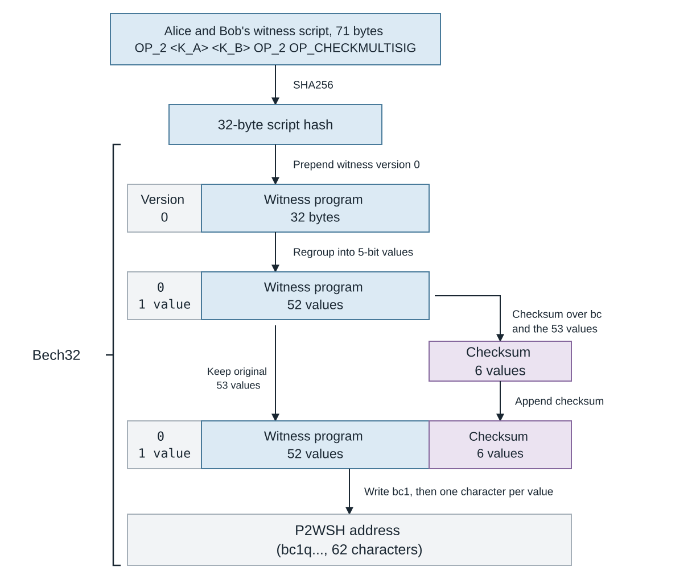
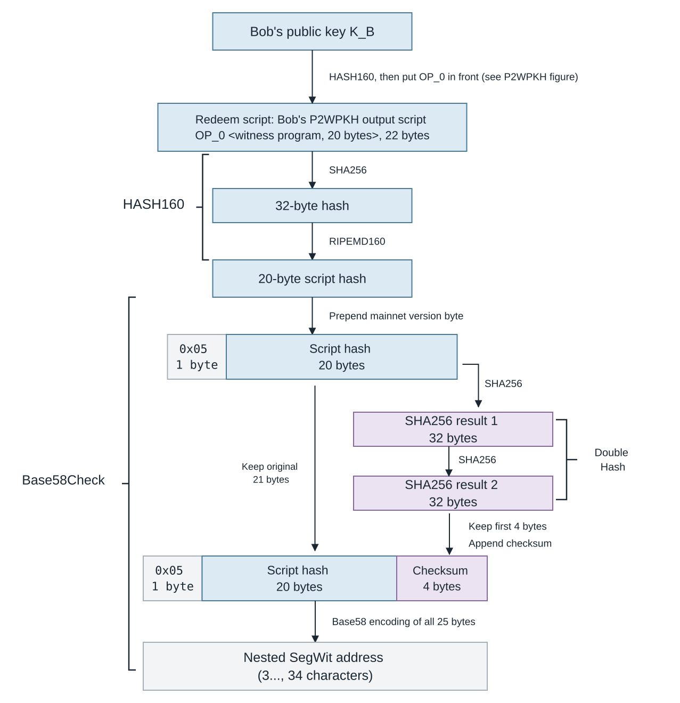

Alice asks Bob for his Bitcoin address, and Bob's wallet gives him a choice. One address starts with `1`, another with `3`, a third with `bc1q`, and a fourth with `bc1p`. Even two `bc1q` addresses can have different lengths.

Why does paying with the same currency need so many kinds of addresses?

Each format is Bitcoin's answer to a new need, and each answer changes two things: what Alice writes into her payment, and what Bob has to show the world when he spends it. We'll follow those needs through a story. Alice and Bob start with a plain payment. Then they open a shop together and want co-custody, so that neither of them can spend alone. Alice wants a refund she can count on before she puts in her savings. And in the end, they'd rather not tell the whole world how their wallet works.

We'll meet the address types in the order they arrived, from `1` in 2009 to `bc1p` in 2021. First, though, we need the two building blocks of every Bitcoin transaction: inputs and outputs.

## 1. Inputs and Outputs

A Bitcoin payment doesn't move coins between accounts. It spends old outputs and creates new ones. When Alice pays Bob, her wallet builds transaction A. Its **output** holds an amount and a **spending condition**: a small script, called the **output script** and stored in the `scriptPubKey` field, that says who can spend this output later. Until someone spends it, the output is an **unspent transaction output**, or **UTXO**. That UTXO is Bob's coin.

Transaction A's **inputs** say where Alice's money comes from. Each input points to one of Alice's earlier UTXOs, by its transaction ID and output index, and supplies the data that satisfies that UTXO's spending condition, such as Alice's signature, in its `scriptSig` field. Later, Bob spends his new UTXO the same way, through an input of transaction B.

<figure style="max-width: 560px; margin: 1.5em auto; text-align: center;">
  
  <figcaption style="margin-top: 0.5em; text-align: center; font-style: italic;">Figure 1. One payment, two transactions</figcaption>
</figure>

So where does the address come in? Bob's address tells Alice's wallet which output script to write into transaction A's output. Different needs call for different conditions: Bob may want to spend alone, while the shop that Alice and Bob open later needs both of their signatures. Bitcoin can also write the same condition in different ways, which changes what goes into the output now and what the spender must supply later. Each address type is one way of writing a condition, so let's meet them one by one.

## 2. Generation 1 (2009): paying to one key

### P2PK: put Bob's public key in the output

P2PK provides a useful starting point for understanding Bitcoin payments, although it has no standard address format of its own. Alice pays directly to Bob's public key embedded in a script. Bob later signs the spending transaction with the corresponding private key.

We call this method **pay to public key**, or **P2PK**. In the example above, transaction A's output and transaction B's spending input contain:

```text
Output scriptPubKey:
  <K_B> OP_CHECKSIG

Later input scriptSig:
  <signature_B>
```

Here, `K_B` is Bob's public key. `OP_CHECKSIG` is an [opcode](https://en.bitcoin.it/wiki/Script), an instruction that checks the signature supplied when the output is spent. Bob supplies that signature in the spending input's `scriptSig` field in transaction B. These legacy signature checks use ECDSA, Bitcoin's original signature scheme.

P2PK puts Bob's full public key on display as soon as Alice broadcasts her payment. With all the buzz around AI and quantum computing, Bob may have every right to worry that a sufficiently powerful quantum computer could recover his private key from the public key in the near future (see [Quantum key recovery](https://bips.dev/360/#motivation)). The public key also takes up space: a compressed encoding occupies 33 bytes, and an uncompressed encoding occupies 65. 

Can Bob receive a payment without putting his full public key on display? Here comes our second player: P2PKH.

### P2PKH (`1...`): give Alice a public-key hash

Bob would like to get paid without putting his full public key on display. A **hash** gives him a way to do that. Think of it as a compact fingerprint calculated from some data. Calculating the hash is easy, but working backwards to recover the original data is designed to be extremely hard.

This is the idea behind **pay to public-key hash**, or **P2PKH**. Bob hashes his public key to get a 20-byte value, smaller than either public-key encoding we just saw. He gives Alice an address containing this hash. To make the hash convenient to share, Bob's address uses **Base58Check**. On Bitcoin's main network, a P2PKH address begins with `1`.

<figure style="max-width: 560px; margin: 1.5em auto; text-align: center;">
  
  <figcaption style="margin-top: 0.5em; text-align: center; font-style: italic;">Figure 2. P2PKH: from public key to address</figcaption>
</figure>

Alice's wallet decodes the address in reverse. It turns the Base58 text back into 25 bytes, checks the checksum, and reads the version byte. Version `0x00` means P2PKH, so the wallet drops the version byte and checksum and places the hash `<HASH160(K_B)>` in the standard P2PKH output script shown below. The checksum never reaches the blockchain. Its only job is to catch typos while the address travels from Bob to Alice.

When Bob later spends that output through transaction B, he supplies his public key and a signature. Bitcoin checks two things: does the supplied public key produce the hash in Alice's output, and is the signature valid for that public key? Bob needs to pass both checks to spend the payment (see [P2PKH validation](https://developer.bitcoin.org/devguide/transactions.html#p2pkh-script-validation)).

```text
Output scriptPubKey:
  OP_DUP OP_HASH160 <HASH160(K_B)> OP_EQUALVERIFY OP_CHECKSIG

Later input scriptSig:
  <signature_B> <K_B>
```

The output now contains the hash, while Bob's public key arrives in the later input. This makes the output script shorter than P2PK's and lets Bob postpone publishing a previously undisclosed public key until he spends. He hasn't become invisible, though. Payments to a reused address remain linkable, and spending reveals the public key (see [Bitcoin privacy and address reuse](https://bitcoin.org/en/protect-your-privacy)).

So far, every payment has had a single owner. Bob holds one key, and that key alone can move his coins. What if the money belongs to two people?

> **Technical note: from Bob's public key to a `1...` address**
>
> **HASH160** makes the public-key hash. **Base58Check** turns that hash into an address. Here's the recipe:
>
> 1. **Hash the public key.** Apply SHA256 to the public-key bytes, then RIPEMD160 to the result. This is HASH160, which produces a 20-byte hash.
> 2. **Add the version byte.** Prepend `0x00` for a mainnet P2PKH address. The version byte and hash together occupy 21 bytes.
> 3. **Add the checksum.** Apply SHA256 twice to those 21 bytes and take the first four bytes of the result. Append this checksum, giving 25 bytes in total.
> 4. **Encode as Base58.** Convert all 25 bytes into Base58 text. Each leading zero byte becomes a leading `1`, which explains the mainnet P2PKH prefix.
>
> **Worked example**
>
> Using the illustrative compressed public key from BIP 173:
>
> ```text
> Public key (33 bytes)
> 0279be667ef9dcbbac55a06295ce870b07029bfcdb2dce28d959f2815b16f81798
>
> HASH160 (20 bytes)
> 751e76e8199196d454941c45d1b3a323f1433bd6
>
> Checksum (4 bytes)
> 510d1634
>
> P2PKH address
> 1BgGZ9tcN4rm9KBzDn7KprQz87SZ26SAMH
> ```
>
> The checksum helps catch typing errors. It doesn't confirm that an address belongs to Bob (see [Address conversion](https://developer.bitcoin.org/reference/transactions.html#address-conversion)).
>
> **Why SHA256 twice?** Satoshi left us the code, but his reason for the second round remains unclear. Pieter Wuille notes that he knows of no benefit from double hashing in this checksum use case (see [Wuille's explanation](https://bitcoin.stackexchange.com/questions/110065/checksum-sha256sha256prefixdata-why-double-hashing)).

## 3. Generation 2 (2012): paying to a script

### P2SH (`3...`): when the script is too long to hand to the payer

Alice and Bob decide to open a small shop together. Customers will pay into a shared wallet, and Alice will put in some of her savings to get the shop started. Neither of them wants the other to be able to empty that wallet alone. They want **co-custody**: the coins should move only when both of them agree.

A single-key script can't express that rule. Bitcoin's script language can, through a **multisignature** condition, or **multisig** for short. Like P2PK, a bare multisig output puts public keys directly in the output. This time there are two keys, and a rule saying how many signatures are needed:

```text
Output scriptPubKey:
  OP_2 <K_A> <K_B> OP_2 OP_CHECKMULTISIG

Later input scriptSig:
  <signature_A> <signature_B>
```

Here, `K_A` is Alice's public key, and `K_B` is Bob's. The first `OP_2` says that two signatures are required, and the second says that two public keys are listed. `OP_CHECKMULTISIG` checks the signatures against the listed keys. In general, a bare multisig `scriptPubKey` takes the form `OP_m <n public keys> OP_n OP_CHECKMULTISIG`. It lists $ n $ keys and accepts any $ m $ of their signatures.

> **Technical note: the dummy `OP_0`**
>
> The `scriptSig` above is simplified. Because of an off-by-one quirk in the original `OP_CHECKMULTISIG` implementation, the opcode consumes one extra element, so a real spend supplies `OP_0 <signature_A> <signature_B>`. The leading `OP_0` pushes that empty element. The same dummy appears in the P2SH spend below. It is unrelated to the witness-version marker that appears later in SegWit output scripts.

Multisig gives Alice and Bob the rule they want. The trouble is that every customer who pays the shop now has to put the whole multisig script into the payment's output. There is no standard address for a bare multisig script, so the shop would have to hand customers the script itself, and their wallets would have to know how to build that output. The customers also pay the fee for it. With two compressed keys, the script takes 71 bytes, compared with 25 bytes for a P2PKH output script. It then sits in the UTXO set that every full node keeps, until Alice and Bob spend it. And just as with P2PK, both public keys are on display from the moment the customer pays.

Could the shop get paid through a short address, as easily as Bob does with P2PKH? It can, by borrowing P2PKH's trick. Instead of hashing a public key, Alice and Bob hash the whole script.

This is **pay to script hash**, or **P2SH**. Alice and Bob serialize their multisig script, now called the **redeem script**, hash it with HASH160, and encode the 20-byte hash with Base58Check using the mainnet version byte `0x05`. The result is an address beginning with `3` (see [P2SH address specification](https://bips.dev/13/)).

<figure style="max-width: 560px; margin: 1.5em auto; text-align: center;">
  
  <figcaption style="margin-top: 0.5em; text-align: center; font-style: italic;">Figure 3. P2SH: from redeem script to address</figcaption>
</figure>

A customer's wallet decodes the address just as Alice's wallet decodes a P2PKH address. Version `0x05` means P2SH, so the wallet places the 20-byte hash in the standard P2SH output script. A customer's payment now contains:

```text
Output scriptPubKey:
  OP_HASH160 <HASH160(redeem_script)> OP_EQUAL

Later input scriptSig:
  <signature_A> <signature_B> <redeem_script>

Redeem script:
  OP_2 <K_A> <K_B> OP_2 OP_CHECKMULTISIG
```

The redeem script has moved from the output to the later input. When Alice and Bob spend, Bitcoin checks two things. Does the supplied redeem script hash to the value in the output, and do the signatures satisfy the redeem script once it runs? Both checks must pass (see [P2SH validation](https://bips.dev/16/)).

The customer's output is now 23 bytes, however long the script behind it. Customers pay to a familiar-looking address and pay a small fee. Alice and Bob carry the long script and pay for its bytes when they spend. The UTXO set holds only a hash, and the keys stay out of sight until the spend. As with P2PKH, that spend reveals everything, and payments to a reused address remain linkable.

Now co-custody is settled. But Alice has one more worry before she moves her savings into the shop's wallet: what happens if Bob stops cooperating? She wants a signed refund transaction before she broadcasts the transaction that funds their wallet.

## 4. Generation 3 (2017): moving signatures to the witness

### Why SegWit: a refund needs a dependable reference

Call their funding transaction `F`. The refund must name the output it spends, using `F`'s transaction ID and output index. Bob signs a refund returning the payment to Alice after an agreed deadline. Alice can then broadcast `F`, knowing she has a way to recover the funds if the deal fails.

In the transaction format we have seen so far, the data used to calculate `F`'s transaction ID include the input signatures. A signature can change without changing what the payment does. For example, anyone who sees `F` before it confirms can rewrite an ECDSA signature into a second valid form. The result spends the same UTXOs and pays the same outputs, yet has a different transaction ID. This is called **transaction malleability**. If the modified version confirms, the original `F` never can, and the prepared refund points to an output that will never exist.

> **Technical note: isn't malleability already fixed?**
>
> An ECDSA signature is a pair of numbers, $ (r, s) $. If $ (r, s) $ is a valid signature, then $ (r, n-s) $ is valid too, where $ n $ is the order of the secp256k1 curve's group. Anyone can make this swap without the private key. The **low-s** rule keeps only the version with the smaller $ s $.
>
> However, the low-s rule fixes the problem only partly. Bitcoin Core enforces low-s as a relay policy, not as a consensus rule. Nodes won't pass along a high-s version of `F`, but a miner can still include one in a block, because consensus accepts it. The proposal to make low-s a consensus rule was never activated (see [BIP 146](https://bips.dev/146/)). Since 2015, consensus has required strictly encoded signatures, which closed a different source of malleability (see [BIP 66](https://bips.dev/66/)). Other sources remain, such as a miner adding an extra, unused item to the `scriptSig` of a legacy input (see [BIP 62](https://bips.dev/62/)). Malleability became unlikely, but a presigned refund needs it to be impossible. SegWit provides that by leaving signatures out of the `txid`.

SegWit gives signatures and keys a separate place in the transaction: the **witness structure**. The transaction ID, `txid`, leaves out the witness (short for witness structure, the term we'll use from now on). A second identifier, `wtxid`, includes it. Changing only the witness therefore leaves `txid` unchanged (see [SegWit transaction serialization](https://bips.dev/144/)).

<figure style="max-width: 560px; margin: 1.5em auto; text-align: center;">
  
  <figcaption style="margin-top: 0.5em; text-align: center; font-style: italic;">Figure 4. Legacy vs. SegWit: where the signatures go</figcaption>
</figure>

There's one catch. Where Alice's signatures go depends on the addresses of the coins `F` spends, not on the addresses `F` pays. If those coins sit at SegWit addresses, such as the P2WPKH type below, her signatures go into the witness. Then changing them no longer changes `F`'s ID, and the refund Bob signed stays valid.

<figure style="max-width: 560px; margin: 1.5em auto; text-align: center;">
  
  <figcaption style="margin-top: 0.5em; text-align: center; font-style: italic;">Figure 5. Legacy vs. SegWit input: the signatures move to the witness</figcaption>
</figure>

SegWit makes chains of presigned transactions easier to construct, including those used in payment channels. It is one reason SegWit mattered to the development of Lightning (see [SegWit benefits](https://bitcoincore.org/en/2016/01/26/segwit-benefits/)).

### Capacity, spending costs, and future upgrades

SegWit also changed how Bitcoin measures block capacity. The **weight** calculation gives different weights to base data and witness data. A transaction's **virtual size**, measured in virtual bytes, translates that weight into the quantity commonly used for fee rates.

> **Technical note: weight and virtual size**
>
> Let $ B $ be the transaction's base serialized size and $ T $ its total serialized size including witness. Then $ W = 3B + T $ weight units, and $ \mathrm{vsize} = \lceil W/4 \rceil $. The marker and flag are included in $ T $ and excluded from $ B $. Bitcoin's block limit is 4,000,000 weight units (see [size rules](https://bips.dev/141/#other-consensus-critical-limits)).

Moving signatures and keys to the witness can reduce the virtual size of a comparable payment. At the same fee rate, fewer virtual bytes mean a smaller fee. The actual comparison depends on the input and output types involved. SegWit also introduced a revised signature-hashing method for version 0 witness spends that avoids repeated hashing work and includes the spent output's value in the signed data (see [Version 0 signature verification](https://bips.dev/143/)).

Finally, SegWit gives outputs a new standard shape: a **witness version** followed by a **witness program**. The witness program is the data that a later witness must match, such as a public-key hash or a script hash, and the version says which rules apply. Version 0 introduced the native constructions below, while version 1 later provided the basis for Taproot.

<figure style="max-width: 560px; margin: 1.5em auto; text-align: center;">
  
  <figcaption style="margin-top: 0.5em; text-align: center; font-style: italic;">Figure 6. Legacy vs. SegWit output: a witness version and a witness program</figcaption>
</figure>

Alice and Bob's next question would be: how does a receiving address tell Alice's wallet which witness program to put in the output? 

### P2WPKH (`bc1q...`): P2PKH with the signature moved out

Start with the simplest case: Alice pays Bob, and Bob spends alone. This also settles the catch from earlier, because coins held at this kind of address are exactly the coins whose signatures go into the witness.

**Pay to witness public-key hash**, or **P2WPKH**, is P2PKH rebuilt for SegWit. Bob starts from the same 20-byte HASH160 of his public key. This time the hash becomes a witness program, with witness version 0 in front of it. Instead of Base58Check, Bob's address uses a new encoding, **Bech32**. On Bitcoin's main network, a P2WPKH address begins with `bc1q`.

<figure style="max-width: 560px; margin: 1.5em auto; text-align: center;">
  
  <figcaption style="margin-top: 0.5em; text-align: center; font-style: italic;">Figure 7. P2WPKH: from public key to address</figcaption>
</figure>

Alice's wallet decodes the address in reverse. It checks the checksum, reads `bc` as the main network, and turns the 33 data values back into witness version 0 and the 20-byte witness program. It then writes them as the output script `OP_0 <HASH160(K_B)>`. As with P2PKH, the checksum never reaches the blockchain.

When Bob later spends that output through transaction B, he leaves `scriptSig` empty and supplies his signature and public key in the witness. Bitcoin runs the same two checks as for P2PKH: does the public key hash to the witness program, and is the signature valid for that key (see [witness program rules](https://bips.dev/141/#witness-program))?

```text
Output scriptPubKey:
  OP_0 <HASH160(K_B)>

Later input scriptSig:
  (empty)

Later witness:
  <signature_B> <K_B>
```

Notice that the output has no `OP_CHECKSIG`, and no `OP_DUP` or `OP_EQUALVERIFY` either. Version 0 with a 20-byte witness program is enough to tell every node to run the P2PKH checks itself, using the witness program as the public-key hash. The output script shrinks from 25 bytes to 22, and Bob's signature and key move to the witness, where they weigh less. The privacy story is the same as for P2PKH: spending reveals the public key, and payments to a reused address remain linkable.

Bob's ordinary payment is covered. But how can the shop's co-custody wallet use SegWit?

> **Technical note: from Bob's public key to a `bc1q...` address**
>
> **HASH160** makes the witness program, as before. **Bech32** turns the witness version and witness program into an address. Here's the recipe:
>
> 1. **Hash the public key.** Apply HASH160 to the public key, exactly as for P2PKH. The 20-byte result is the witness program.
> 2. **Regroup into 5-bit values.** The witness version 0 becomes one 5-bit value. The witness program's 160 bits become 32 values of 5 bits each.
> 3. **Add the checksum.** Calculate a 6-value checksum over the network prefix `bc` and the 33 data values, and append it.
> 4. **Write it out.** Write the prefix `bc`, the separator `1`, then each 5-bit value as one character of the alphabet `qpzry9x8gf2tvdw0s3jn54khce6mua7l`. Value 0 is `q`, which is why version 0 addresses begin with `bc1q`. The address has 2 + 1 + 33 + 6 = 42 characters.
>
> **Worked example**
>
> Using the same public key as in the P2PKH example:
>
> ```text
> Witness program, HASH160 (20 bytes)
> 751e76e8199196d454941c45d1b3a323f1433bd6
>
> Output script (22 bytes)
> 0014751e76e8199196d454941c45d1b3a323f1433bd6
>
> P2WPKH address
> bc1qw508d6qejxtdg4y5r3zarvary0c5xw7kv8f3t4
> ```
>
> In the output script, `0x00` encodes `OP_0`, and `0x14` pushes the next 20 bytes. The address and the earlier `1BgGZ9tcN4rm9KBzDn7KprQz87SZ26SAMH` share the same hash but describe different outputs, so Alice's wallet builds a different script for each (see [Bech32 specification and test vectors](https://bips.dev/173/)).
>
> **Why a new encoding?** Bech32 uses a single case and leaves out the look-alike characters `1`, `b`, `i`, and `o`. Its checksum is guaranteed to catch up to four wrong characters. Uppercase and lowercase are both valid, but a mixed-case address is rejected. Because case doesn't matter, a wallet can show the address in all capitals inside a QR code, where capitals take less space than lowercase letters. A case-sensitive Base58 address can't do that.

### P2WSH (`bc1q...`): P2SH with the signatures moved out

The shop's wallet takes the same path that Bob's payment just took. P2WPKH rebuilt P2PKH for SegWit, and **pay to witness script hash**, or **P2WSH**, rebuilds P2SH. Alice and Bob keep their 2-of-2 multisig script, which now goes by a new name, the **witness script**. It plays the role the redeem script played in P2SH, with one change in the hashing: Alice and Bob use SHA256 instead of HASH160, which gives a 32-byte hash instead of a 20-byte one. That hash becomes the witness program behind witness version 0, and Bech32 turns them into an address. A P2WSH address also begins with `bc1q`, but it has 62 characters instead of 42.

<figure style="max-width: 560px; margin: 1.5em auto; text-align: center;">
  
  <figcaption style="margin-top: 0.5em; text-align: center; font-style: italic;">Figure 8. P2WSH: from witness script to address</figcaption>
</figure>

A customer's wallet decodes the address just as Alice's wallet decodes a P2WPKH address. This time the witness program is 32 bytes, so the wallet writes the output script `OP_0 <SHA256(witness_script)>`. The length of the witness program tells every node which rules to use: 20 bytes means P2WPKH, and 32 bytes means P2WSH.

When Alice and Bob spend, they leave `scriptSig` empty and put everything in the witness: their two signatures, followed by the witness script itself. Bitcoin checks two things, just as for P2SH. Does the witness script hash to the witness program, and do the signatures satisfy the witness script once it runs (see [witness program rules](https://bips.dev/141/#witness-program))?

```text
Output scriptPubKey:
  OP_0 <SHA256(witness_script)>

Later input scriptSig:
  (empty)

Later witness:
  <signature_A> <signature_B> <witness_script>

Witness script:
  OP_2 <K_A> <K_B> OP_2 OP_CHECKMULTISIG
```

As with the P2SH spend, the witness above is simplified. A real spend starts with the dummy empty element that `OP_CHECKMULTISIG` consumes.

So what does the shop gain? The customer's output actually grows, from 23 bytes for P2SH to 34 bytes for P2WSH. In exchange, the 71-byte witness script and both signatures move to the witness, where they weigh less, so spending the shop's coins costs less. Transactions that spend those coins also get SegWit's protection from malleability, which matters for chains of presigned transactions. The full script is still revealed when the shop spends, just as with P2SH.

Bob is ready to receive native SegWit payments. Now suppose Alice's wallet can send to `3...` addresses but does not understand Bech32. They need an address her wallet can interpret.

> **Technical note: why a 32-byte hash?**
>
> P2SH's 20-byte hash is safe against a stranger, who would have to find a script matching a hash that already exists. The danger comes from inside a joint agreement. A dishonest partner who helps write the script could search for two different scripts with the same hash: the honest 2-of-2 script, and one that pays only them. Finding such a pair, called a **collision**, takes about $ 2^{80} $ hash calculations for a 20-byte hash. That is no longer out of reach: by the end of 2015, Bitcoin miners had already computed about $ 2^{84} $ hashes in total. A 32-byte hash raises the cost to about $ 2^{128} $ (see [BIP 141](https://bips.dev/141/)).
>
> Two smaller changes came with SegWit:
>
> 1. A witness script can be up to 10,000 bytes, while a P2SH redeem script is limited to 520 bytes.
> 2. The dummy element (i.e., `OP_0` in P2SH) is now locked down. Since `OP_CHECKMULTISIG` never looks at it, anyone relaying a multisig spend used to be able to replace it with some other value, which changed the txid, the same malleability problem we met with Alice's refund. The SegWit soft fork added a rule that the dummy element must be empty, in legacy and SegWit spends alike, so nobody can swap it (see [BIP 147](https://bips.dev/147/)).

### Nested SegWit (`3...`): P2WPKH wrapped in P2SH

Bob doesn't have to wait for Alice's wallet to catch up. He takes his P2WPKH output script, `OP_0 <witness program, 20 bytes>`, and treats it as a P2SH redeem script. He hashes those 22 bytes (`OP_0`, one push byte, and the 20-byte witness program) with HASH160 and encodes the result with Base58Check and version byte `0x05`, exactly as Alice and Bob did for the shop's P2SH address. The result is an ordinary-looking `3...` address. This construction is **P2SH-P2WPKH**, often called **nested SegWit**.

<figure style="max-width: 560px; margin: 1.5em auto; text-align: center;">
  
  <figcaption style="margin-top: 0.5em; text-align: center; font-style: italic;">Figure 9. Nested SegWit: P2WPKH wrapped in P2SH</figcaption>
</figure>

Alice's wallet decodes the address like any other P2SH address. Version `0x05` means P2SH, so it writes the standard P2SH output script. Her wallet never needs to know that SegWit is involved.

When Bob spends, his `scriptSig` holds exactly one item, the redeem script, and his signature and public key go in the witness. Validation runs in two layers. First, the P2SH layer checks that the redeem script hashes to the value in Alice's output. Then nodes see that the redeem script is a witness version followed by a witness program, and apply the P2WPKH rules: does `K_B` hash to the witness program, and is the signature valid for that key (see [nested witness programs](https://bips.dev/141/#witness-program))?

```text
Output scriptPubKey:
  OP_HASH160 <HASH160(redeem_script)> OP_EQUAL

Later input scriptSig:
  <redeem_script>

Later witness:
  <signature_B> <K_B>

Redeem script:
  OP_0 <HASH160(K_B)>
```

The wrapper has a cost. Compared with native P2WPKH, Bob's spend carries 23 extra bytes in `scriptSig`: the 22-byte redeem script and the byte that pushes it. Those bytes sit outside the witness, so they count at full weight. In return, Alice can pay Bob today, and Bob still gets SegWit's protection from malleability. His signature sits in the witness, and the rules allow nothing in `scriptSig` except that one push of the redeem script, so nobody can change it. Because wallets like Alice's could already pay nested addresses, Bitcoin Core's own wallet handed them out by default from 2018, until it switched to Bech32 in 2019 for the GUI and 2020 for RPC (see release notes for versions [0.16](https://bitcoincore.org/en/releases/0.16.0/), [0.19](https://bitcoincore.org/en/releases/0.19.0.1/), and [0.20](https://bitcoincore.org/en/releases/0.20.0/)).

A `3...` address doesn't tell you what it wraps. Until Bob spends, his nested SegWit address looks just like the shop's P2SH multisig address. P2SH can wrap P2WSH in the same way, which gives **P2SH-P2WSH** (see [SegWit wallet development guide](https://bitcoincore.org/en/segwit_wallet_dev/)).

One thing still bothers Alice and Bob. Whether the shop uses P2SH or P2WSH, every spend puts both keys, both signatures, and the 2-of-2 rule on display. If the two of them always sign together anyway, why should the whole world learn about their agreement? Here comes our last player: Taproot.

## 5. Generation 4 (2021): keeping the agreement private

### Taproot (`bc1p...`): P2PK and P2WSH in one output

Taproot starts from a new kind of signature. Signatures in a Taproot witness are **Schnorr signatures** instead of ECDSA signatures, and Schnorr signatures have a handy property: keys and signatures from several people can be combined into one. With a protocol such as [MuSig2](https://bips.dev/327/), Alice and Bob can merge their public keys `K_A` and `K_B` into a single public key, the **internal key** `P`. To spend, they work together to produce one signature. Both of them must still take part, so the 2-of-2 rule holds, but the result looks exactly like one person signing.

A single combined key has a weakness, though. If Bob disappears, Alice can never move the shop's coins again. So Taproot lets them add backup conditions, written as scripts. Alice and Bob might agree on two backup scripts:

1. Backup script A: after a deadline, Alice alone can take the coins, the same promise her refund transaction gave her.
2. Backup script B: after a later deadline, Bob alone can take the coins, in case Alice is the one who disappears.

Taproot hashes backup scripts A and B into a **script tree**. Each script becomes a **leaf hash**, Leaf A hash and Leaf B hash, and the two leaf hashes are hashed together into the **script tree root**. Taproot mixes the script tree root into the internal key `P` and gets the **output key** `Q`. The 32-byte output key `Q` is the witness program behind witness version 1. A new encoding, **Bech32m**, turns witness version 1 and `Q` into an address beginning with `bc1p`. This output type is **pay to Taproot**, or **P2TR**.

<figure style="max-width: 560px; margin: 1.5em auto; text-align: center;">
  
  <figcaption style="margin-top: 0.5em; text-align: center; font-style: italic;">Figure 10. Taproot: from two keys and two backup scripts to address</figcaption>
</figure>

A customer's wallet decodes the address like a P2WSH address, except that the checksum is Bech32m and the witness version is now 1. It writes the output script `OP_1 <Q>`, which holds the witness version and the 32-byte output key.

Taproot gives the shop two ways to spend, the **key path** and the **script path**. On the key path, Alice and Bob sign together, and the witness holds one 64-byte Schnorr signature. Bitcoin checks one thing: is the signature valid for `Q`? On the script path, Alice or Bob uses one backup script. When Alice uses backup script A, the witness holds three items: her signature `<signature_A>`, backup script A itself, and a **control block** that proves backup script A was mixed into `Q`. The control block carries the internal key `P` and the hashes needed to rebuild the script tree root, called the **Merkle path**. In our example, the Merkle path is just Leaf B hash. Bitcoin checks that proof, then runs backup script A (see [Taproot spending rules](https://bips.dev/341/)).

```text
Output scriptPubKey:
  OP_1 <Q>

Later input scriptSig:
  (empty)

Later witness, key path:
  <signature_AB>

Later witness, script path:
  <signature_A> <backup_script_A> <control_block>

Backup script A:
  <deadline> OP_CHECKLOCKTIMEVERIFY OP_DROP <K_A> OP_CHECKSIG
```

<figure style="max-width: 560px; margin: 1.5em auto; text-align: center;">
  
  <figcaption style="margin-top: 0.5em; text-align: center; font-style: italic;">Figure 11. Taproot: the key path and the script path</figcaption>
</figure>

So the key path is for everyday spending, and the script path is for the backups, used only if Alice or Bob disappears. This split is what keeps the agreement private. With P2WSH, every spend puts both keys, both signatures, and the 2-of-2 rule on display. With Taproot, when Alice and Bob spend through the key path, the blockchain sees one key and one signature, exactly what one person paying from a Taproot address would look like. Nobody can tell that two people share the wallet, or that backup scripts exist. Even if Alice uses the script path one day, she reveals only backup script A, while backup script B stays hidden behind Leaf B hash.

The shop now has the best of both worlds: everyday spends that look like one person paying, and backup scripts that only appear on the blockchain if one is ever needed.

> **Technical note: inside a `bc1p...` address**
>
> 1. **Combine the keys.** MuSig2 turns `K_A` and `K_B` into the internal key `P`. Taproot writes public keys in 32 bytes by keeping only the x-coordinate of the curve point (see [Schnorr signatures](https://bips.dev/340/)).
> 2. **Hash the backup scripts.** Each script is hashed with a **tagged hash**, SHA256 with a label mixed in, so that hashes made for different purposes can never be confused. With several scripts, pairs of hashes are hashed together until one 32-byte script tree root remains.
> 3. **Tweak the key.** A tagged hash of `P` and the script tree root gives the tweak $ t $, and the output key is $ Q = P + tG $, where $ G $ is the curve's fixed starting point. Alice and Bob can still sign for `Q`, because MuSig2 lets them include the tweak when they sign together. Anyone shown `P`, a backup script, and its Merkle path can check that the script was mixed into `Q`.
> 4. **Encode with Bech32m.** The steps match Bech32: version 1 becomes the character `p`, the 32-byte witness program becomes 52 values, and a 6-value checksum follows, for 62 characters in total.
>
> **Why Bech32m?** Bech32 had a flaw: if an address ends in `p`, inserting or deleting `q` characters just before that `p` can go undetected. Version 0 addresses were safe because their witness programs must be exactly 20 or 32 bytes, so a changed length is rejected. Later witness versions allow other lengths, so Bech32m changes one constant in the checksum to remove the flaw. Version 0 addresses still use Bech32, and version 1 and later use Bech32m (see [Bech32m specification](https://bips.dev/350/)).
>
> **A new script language.** Backup scripts follow **Tapscript** rules. Signatures inside them are Schnorr signatures, and the old `OP_CHECKMULTISIG` is disabled. A script that needs several signatures uses `OP_CHECKSIGADD` instead (see [Tapscript specification](https://bips.dev/342/)).
>
> **One step back.** Like P2PK, a Taproot output puts a public key, the output key `Q`, directly in the output, where it stays visible for as long as the coins are unspent. A future quantum computer would have all that time to work out the private key behind `Q`. This is the same worry Bob had about P2PK. Hence, a new draft proposal called *pay to Merkle root (P2MR)* would add a Taproot-like output that keeps only the script path. Its output holds only the script tree root, a hash, so no public key appears on the blockchain until someone spends through a backup script. P2MR addresses would begin with `bc1z` (see [Quantum key recovery](https://bips.dev/360/#motivation)).

## 6. Reading the address, from 1 to bc1

Alice and Bob have come a long way, from Bob's public key sitting in plain sight to a shared wallet that looks like one person paying. Here's the whole family side by side:

| Type | Mainnet address and length | What the address carries | What the spender reveals |
| --- | --- | --- | --- |
| P2PK (2009) | No standard address | A public key, placed directly in the output | A signature |
| P2PKH (2009) | `1...`, 26 to 34 characters | A 20-byte public-key hash, in Base58Check | The public key and a signature |
| P2SH (2012) | `3...`, 34 characters | A 20-byte redeem-script hash, in Base58Check | The redeem script and its signatures |
| P2WPKH (2017) | `bc1q...`, 42 characters | Witness version 0 and a 20-byte witness program (public-key hash), in Bech32 | The public key and a signature, in the witness |
| P2WSH (2017) | `bc1q...`, 62 characters | Witness version 0 and a 32-byte witness program (witness-script hash), in Bech32 | The witness script and its signatures, in the witness |
| Nested SegWit, P2SH-P2WPKH (2017) | `3...`, 34 characters | A 20-byte hash of the redeem script `OP_0 <witness program>`, in Base58Check | The redeem script, then the public key and a signature in the witness |
| P2TR (2021) | `bc1p...`, 62 characters | Witness version 1 and a 32-byte witness program (output key `Q`), in Bech32m | Key path: one signature. Script path: one backup script, its signature, and its control block |

The address tells the payer's wallet what to write into the output, and the type decides what the spender must show later. The prefix and checksum exist only for the address: the wallet checks them, strips them off, and they never reach the blockchain. 

From `3...` onward, each new output type arrived through a soft fork. Upgraded nodes enforced the new rules, while nodes that did not upgrade kept accepting the same blocks. Nothing was switched off along the way, so a wallet today can still pay a `1...` address.

Next time someone hands you a string starting with `1`, `3`, `bc1q`, or `bc1p`, you'll know what's inside: a hash of a key, a hash of a script, or a key with scripts hiding behind it. Each one is a different answer to the question Alice and Bob kept asking: who can spend this money, and what do they have to show the world when they do?
